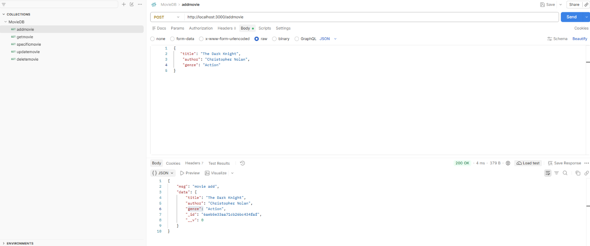
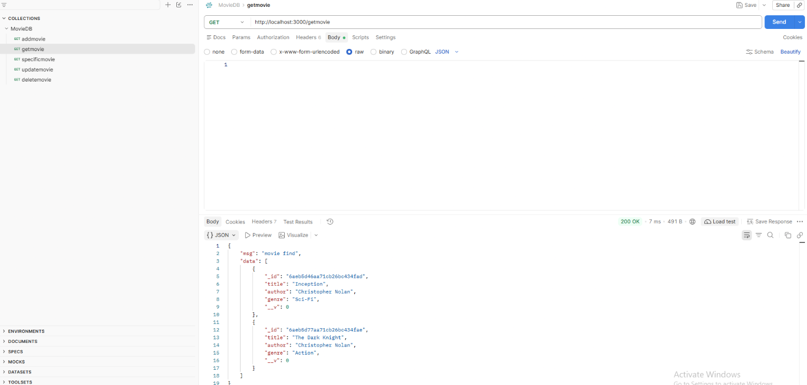
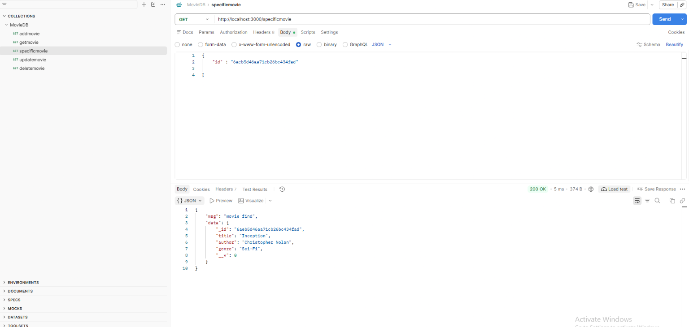
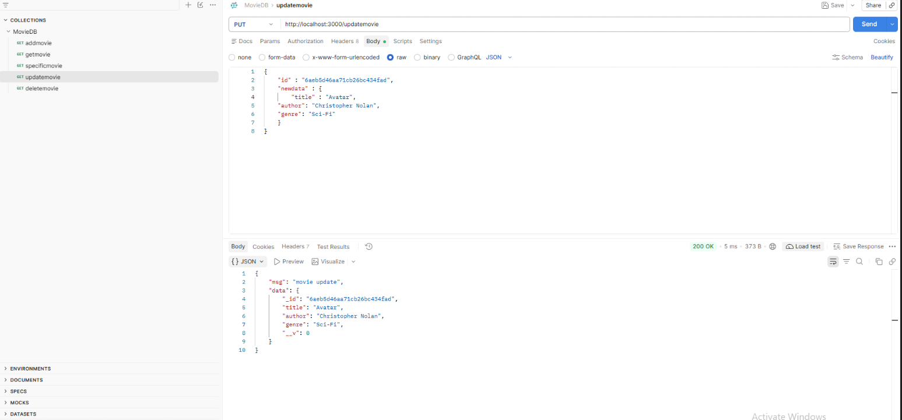
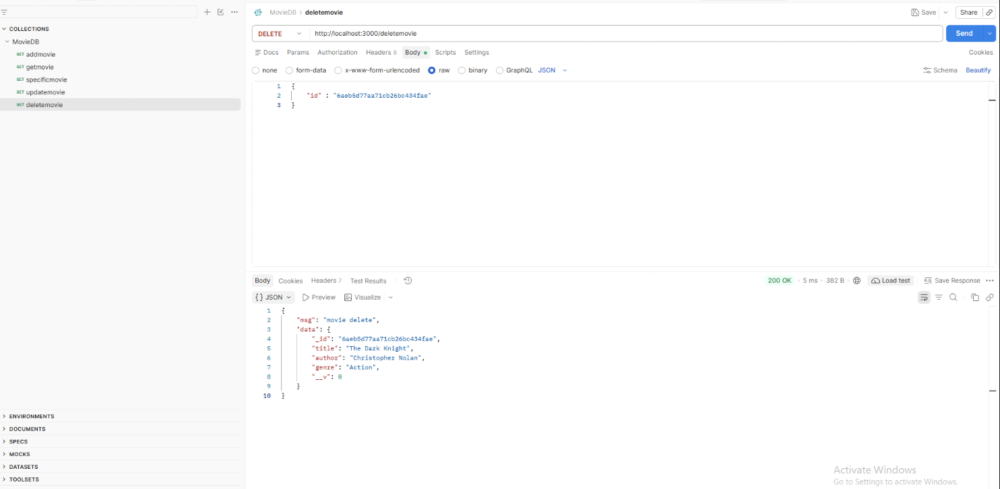

# 🎬 MovieDB --- Movie Management REST API

A simple **Movie Management REST API** built with **Node.js, Express.js,
MongoDB, and Mongoose**. MovieDB lets you create, read, update, and
delete movie records through HTTP API requests.

------------------------------------------------------------------------

## ✨ Features

-   **Add Movie** --- Save a new movie with its title, author, and
    genre.
-   **Get All Movies** --- Retrieve all movies stored in MongoDB.
-   **Get Specific Movie** --- Find a movie using its title.
-   **Update Movie** --- Update an existing movie using its MongoDB
    document ID.
-   **Delete Movie** --- Delete a movie using its MongoDB document ID.
-   **JSON API** --- Send and receive data in JSON format.
-   **MongoDB Integration** --- Store movie records in a MongoDB
    database using Mongoose.

## 🛠️ Tech Stack

  Technology                Purpose
  ------------------------- ---------------------------------------------------
  Node.js                   JavaScript runtime
  Express.js                Build the REST API and handle HTTP requests
  MongoDB                   Store movie data
  Mongoose                  Define the movie schema and interact with MongoDB
  Postman                   Test API endpoints
  JavaScript (ES Modules)   Project programming language

## 📁 Project Structure

``` text
MovieDB/
├── node_modules/       # Installed project dependencies
├── package.json        # Project details and scripts
├── package-lock.json   # Locked dependency versions
├── server.js           # Express server, MongoDB connection, and API routes
└── README.md           # Project documentation
```

## ⚙️ Requirements

Before running the project, install:

-   [Node.js](https://nodejs.org/)
-   [MongoDB Community
    Server](https://www.mongodb.com/try/download/community)
-   [MongoDB Compass](https://www.mongodb.com/products/tools/compass)
-   [Postman](https://www.postman.com/downloads/)

## 🚀 Installation and Setup

### 1. Open the project folder

``` bash
cd /d D:\Nityen\movie_pro_node
```

### 2. Install dependencies

``` bash
npm install
```

### 3. Start MongoDB

Make sure your local MongoDB server is running.

### 4. Configure the database connection

The project uses this local MongoDB connection string:

``` text
mongodb://127.0.0.1:27017/movie
```

The database name is `movie`. Mongoose creates the database and
collection when data is first saved.

### 5. Start the application

``` bash
npm start
```

When the application starts successfully, the terminal should show
messages similar to:

``` text
MongoDB Connected Successfully
Server Started on Port 3000
```

### 6. Open the API

Base URL:

``` text
http://localhost:3000
```

## 🔌 API Endpoints

All endpoints use the base URL `http://localhost:3000`.

  Method   Endpoint           Description
  -------- ------------------ -------------------------
  GET      `/`                Check the home route
  POST     `/addmovie`        Add a new movie
  GET      `/getmovie`        Get all movies
  GET      `/specificmovie`   Find one movie by title
  PUT      `/updatemovie`     Update a movie by ID
  DELETE   `/deletemovie`     Delete a movie by ID

## 🧪 Test the API with Postman

Choose the HTTP method and enter the endpoint URL in Postman. For
requests with a JSON body, select **Body → raw → JSON**.

### 1. Add a Movie

**POST** `http://localhost:3000/addmovie`

``` json
{
  "title": "Dark",
  "author": "Movie King",
  "genre": "Thriller"
}
```

### 2. Get All Movies

**GET** `http://localhost:3000/getmovie`

No request body is required.

### 3. Get a Specific Movie

**GET** `http://localhost:3000/specificmovie`

``` json
{
  "title": "Dark"
}
```

This route reads the title from `req.body`. If your Postman or HTTP
client does not send a body with GET requests, use a client that
supports it or change the route to use a query parameter.

### 4. Update a Movie

**PUT** `http://localhost:3000/updatemovie`

Replace `YOUR_MOVIE_ID` with the `_id` returned when the movie was
created or retrieved.

``` json
{
  "id": "YOUR_MOVIE_ID",
  "newdata": {
    "title": "Dark",
    "author": "Movie King",
    "genre": "Mystery"
  }
}
```

### 5. Delete a Movie

**DELETE** `http://localhost:3000/deletemovie`

Replace `YOUR_MOVIE_ID` with the movie's MongoDB `_id`.

``` json
{
  "id": "YOUR_MOVIE_ID"
}
```

## 🗄️ Database Details

-   **Database:** `movie`
-   **Mongoose model:** `Movie`
-   **MongoDB collection:** `movies`
-   **Fields:**
    -   `title` --- Movie title
    -   `author` --- Movie author
    -   `genre` --- Movie genre

Open MongoDB Compass and connect to:

``` text
mongodb://127.0.0.1:27017
```

Then open the `movie` database and the `movies` collection to view saved
documents.

## 🧰 Common Commands

``` bash
# Install dependencies
npm install

# Start the server using the package script
npm start
```


## 🧧 imges











## 📸 video
  https://drive.google.com/file/d/1nEMk2zzpFI9QqrgzaRcuQx_aZI5qhKz5/view?usp=sharing
  


"# movie_pro_node" 
